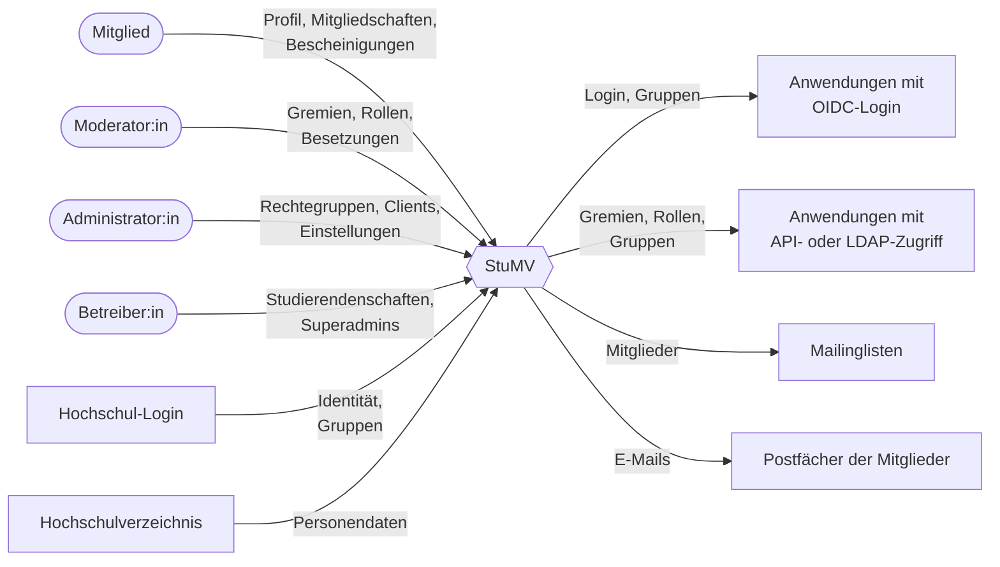
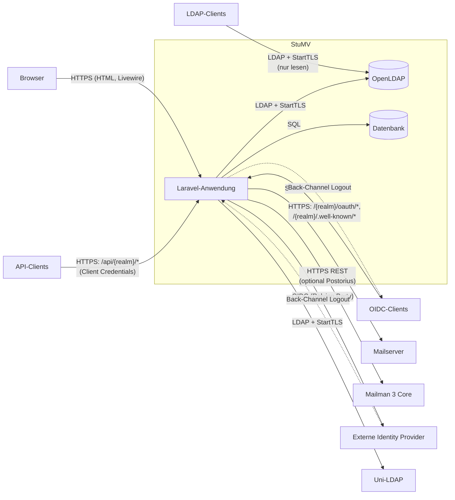

# 3. Kontextabgrenzung

## Fachlicher Kontext

| Partner | Austausch |
| --- | --- |
| **Mitglieder, Moderator:innen, Administrator:innen** | Bedienung über den Browser |
| **Anwendungen mit OIDC-Login** (z. B. Wiki, Cloud, Ticketsystem) | delegieren die Anmeldung an StuMV, erhalten Identität, Profil und Rechtegruppen |
| **Anwendungen mit API- oder LDAP-Zugriff** (z. B. StuFiS) | lesen Gremien, Rollen, Gruppen und Personen |
| **Mailinglisten** (Mailman 3) | Mitglieder werden aus Rechtegruppen abgeleitet |
| **Hochschul-Login** (externer Identity Provider) | Mitglieder melden sich mit ihrem Hochschulkonto an; übermittelte Gruppen können Rollen auslösen |
| **Hochschulverzeichnis** (Uni-LDAP) | Import von Personen und Abgleich ehemaliger Studierender |

## Technischer Kontext

| Schnittstelle | Protokoll | Richtung | Beschreibung |
| --- | --- | --- | --- |
| Weboberfläche | HTTPS | eingehend | Blade/Livewire, Login je Studierendenschaft unter `/{realm}/login` |
| OpenID Connect Provider | HTTPS | eingehend | Authorization Code (mit PKCE), Token, UserInfo, JWKS, Discovery, Introspection, Revocation, End Session – alles unter `/{realm}/…` |
| Verzeichnis-API | HTTPS, JSON | eingehend | nur lesend, siehe [Verzeichnis-API](../api/) |
| Legacy-API | HTTPS, JSON | eingehend | `/api-legacy/…` mit Benutzer-Token, siehe [Risiken](./11-risiken-und-technische-schulden) |
| LDAP | LDAP + StartTLS | beide | StuMV schreibt; andere Dienste lesen mit eigenen Service-Konten |
| Back-Channel Logout | HTTPS | ausgehend | signiertes `logout_token` an Clients mit hinterlegter URL |
| Externe Identity Provider | OIDC | ausgehend, eingehend für Logout | Login über Hochschulkonten |
| Mailman 3 | HTTPS REST | ausgehend | Mitglieder und Moderation von Listen |
| Uni-LDAP | LDAP + StartTLS | ausgehend | nur lesend |
| E-Mail | SMTP | ausgehend | Registrierung, Passwort-Reset, Einladungen, Hinweise zu inaktiven Konten |
