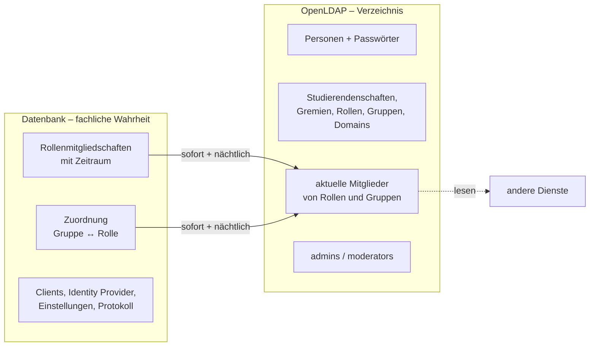

# 4. Lösungsstrategie

| Ziel / Problem | Lösungsansatz | Details |
| --- | --- | --- |
| Rechte zuverlässig an viele Anwendungen weitergeben | **OpenLDAP als Verzeichnis**, das andere Dienste direkt lesen; zusätzlich OIDC und eine REST-API | [3](./03-kontextabgrenzung) |
| Zeitlich begrenzte Funktionen mit Historie | **Mitgliedschaften in der Datenbank** (mit `from`, `until`, Beschluss, Kommentar). Das LDAP enthält nur die *aktuell gültigen* Mitglieder als Projektion. | [ADR 1](./09-architekturentscheidungen#adr-1-mitgliedschaften-in-der-datenbank-ldap-als-projektion) |
| Mandantentrennung | **Studierendenschaft als oberste Ebene**, sowohl im LDAP (`ou=<kürzel>,ou=Communities`) als auch in jeder Route (`/{realm}/…`) und jedem OAuth-Client (`community_uid`). Konten gehören genau einer Studierendenschaft. | [ADR 2](./09-architekturentscheidungen#adr-2-konten-je-studierendenschaft), [ADR 4](./09-architekturentscheidungen#adr-4-oidc-endpunkte-je-studierendenschaft) |
| Ehrenamtliche pflegen selbst | **Abgestufte Zuständigkeiten** (Mitglied, Gremien-Moderator:in, Moderator:in, Administrator:in, Superadmin), die als LDAP-Gruppen abgebildet sind | [8](./08-querschnittliche-konzepte#berechtigungen) |
| Einfache, serverseitige Oberfläche | **Livewire + Flux**: serverseitig gerenderte Komponenten statt einer separaten Single-Page-App | [ADR 5](./09-architekturentscheidungen#adr-5-livewire-und-flux-statt-single-page-app) |
| Einfacher Betrieb | **Kein Queue-Worker**: Änderungen werden sofort synchron ins LDAP geschrieben, langsame Schritte (Mailman) laufen nach der Antwort; ein nächtlicher Abgleich fängt Fehler und zeitgesteuerte Änderungen auf | [ADR 6](./09-architekturentscheidungen#adr-6-kein-queue-worker) |
| Nachvollziehbarkeit | **Aktivitätsprotokoll** für jede fachliche Änderung, Mitgliedschaften werden beendet statt gelöscht | [8](./08-querschnittliche-konzepte#aktivitatsprotokoll) |
| Standardkonformer Identity Provider | **Laravel Passport + OpenID-Connect-Erweiterung** mit eigenen Ergänzungen (Back-Channel Logout, `max_age`, Reuse-Erkennung bei Refresh Tokens) | [8](./08-querschnittliche-konzepte#openid-connect-provider) |
| Produktionsnahe Tests | **Tests gegen echtes OpenLDAP** mit derselben Konfiguration wie in Produktion, statt das Verzeichnis zu mocken | [Tests](../tests) |

## Datenhaltung im Überblick

Im LDAP sind Personen, Passwörter, die Struktur (Studierendenschaften, Gremien, Rollen, Gruppen, Domains) und die Zuständigkeiten (`admins`, `moderators`) die führenden Daten. Die **Mitglieder von Rollen und Rechtegruppen** sind dagegen nur eine Projektion der Datenbank: Wer sie direkt im LDAP ändert, verliert die Änderung beim nächsten Abgleich.
