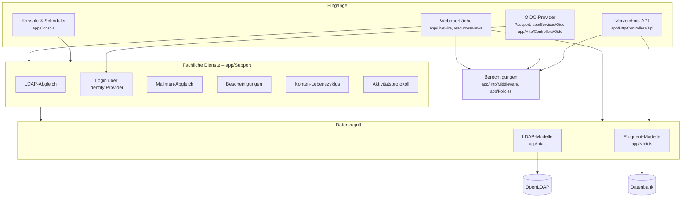
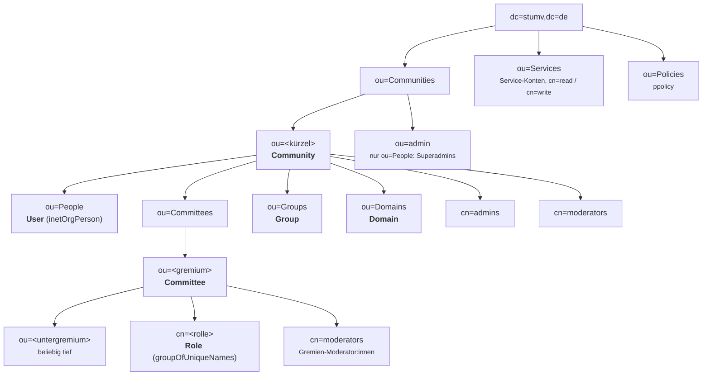

# 5. Bausteinsicht

## Ebene 1: StuMV als Ganzes

| Baustein | Verantwortung |
| --- | --- |
| **Weboberfläche** | Eine Livewire-Komponente pro Seite, eingebunden über `Route::livewire()` in `routes/web.php`. UI-Bibliothek Flux. |
| **OIDC-Provider** | Autorisierung, Tokens, UserInfo, Discovery, Logout – je Studierendenschaft. Details in [8](./08-querschnittliche-konzepte#openid-connect-provider). |
| **Verzeichnis-API** | lesender Zugriff für Clients mit Client Credentials (`routes/api.php`), dazu die ältere `api-legacy` mit Benutzer-Tokens |
| **Konsole & Scheduler** | nächtlicher Abgleich, Aufräumen, Migrations- und Wartungsbefehle |
| **Berechtigungen** | Middleware für Zuständigkeiten (`CommunityMember`, `CommunityModerator`, `CommunityAdmin`, `SuperAdminMiddleware`, `DenyAdminRealm`) und Policies je Fachobjekt |
| **LDAP-Abgleich** | Mitgliedschaften aus der Datenbank ins LDAP übertragen, Unterschiede anzeigen |
| **Login über Identity Provider** | Anmeldung mit Hochschulkonten, Rollen und Gruppen aus übermittelten Gruppen ableiten |
| **Mailman-Abgleich** | Listenmitglieder aus Rechtegruppen ableiten und an Mailman übertragen |
| **Bescheinigungen** | barrierefreie PDF-Tätigkeitsnachweise mit optionalem Anschreiben |
| **Konten-Lebenszyklus** | Registrierung, Einladungen, Anlegen fehlender Datenbankeinträge, Löschen von Konten und ganzen Studierendenschaften |
| **Aktivitätsprotokoll** | jede fachliche Änderung festhalten, sensible Werte ausblenden |
| **LDAP-Modelle** | Zugriff auf das Verzeichnis über LdapRecord |
| **Eloquent-Modelle** | Zugriff auf die Datenbank |

## Ebene 2: Weboberfläche

Die Livewire-Komponenten sind nach Bereich gruppiert; die Blade-Views liegen spiegelbildlich unter `resources/views/livewire/`.

| Verzeichnis | Inhalt | Zuständigkeit |
| --- | --- | --- |
| `Realm/` | Übersicht, Mitglieder, Moderator:innen, Administrator:innen, Studierendenschaften, Aktivitätsprotokoll | je nach Seite |
| `Profile/` | Stammdaten, Bild, Mitgliedschaften, Bescheinigungen, Passwort, Sitzungen, Konto | eigenes Konto, Admins |
| `Committee/` | Gremien, Rollen, Rollenmitgliedschaften, Gremien-Moderator:innen | Moderator:innen |
| `Group/` | Rechtegruppen und ihre Rollen | Admins |
| `Mailman/` | Zuordnung von Gruppen zu Mailinglisten, Mailinglisten-Domains | Admins, Superadmins |
| `Settings/` | Studierendenschaft, Erscheinungsbild, Domains, Export-Vorlagen, OIDC- und API-Clients, Identity Provider | Admins |
| `Tools/` | Einladungen, E-Mail-Abgleich, Uni-LDAP-Import und -Abgleich, ungenutzte Rollen | Moderator:innen, Admins |
| `Auth/`, `RegisterUser`, `AcceptInvitation` | Registrierung, Abschluss einer Registrierung über einen Identity Provider | Gäste |
| `SyncLdap`, `SyncMailman` | Menü „Synchronisieren“ in der Kopfzeile | Admins |

## Ebene 2: LDAP-Modelle

| Modell (`app/Ldap/`) | Besonderheiten |
| --- | --- |
| `Community` | erzeugt mit `generateSkeleton()` die Grundstruktur einer Studierendenschaft; `isAdminRealm()` für die Superadmin-Studierendenschaft |
| `User` | Personen; das globale Scope `ScopedToRealmPeople` beschränkt Anmeldungen auf eine Studierendenschaft, `AddMemberOfAttributeScope` lädt das von `dynlist` erzeugte `memberOf` |
| `Committee` | verschachtelte Gremien über DNs; `roles()`, `moderatorsGroup()`, `parentCommittee()` |
| `Role`, `Group` | `groupOfUniqueNames`; ihre `uniqueMember` werden aus der Datenbank befüllt |
| `Domain` | Domains für die automatische Zuordnung bei der Registrierung |
| `Uni\User` | Personen im Hochschulverzeichnis (zweite LDAP-Verbindung `uni`) |

## Ebene 2: Datenbank

Wichtige Tabellen bzw. Modelle (`app/Models/`):

| Modell | Tabelle | Inhalt |
| --- | --- | --- |
| `User` | `user` | Spiegel eines LDAP-Kontos je `(username, realm)`, verknüpft über `uid` = `entryUUID` |
| `RoleMembership` | `role_user_relation` | Person × Rolle mit `from`, `until`, `decided`, `comment`, optional `identity_provider_id` |
| `GroupMembership` | `role_group_relation` | Rechtegruppe × Rolle (DNs) |
| `PassportClient` | `oauth_clients` | OIDC- und API-Clients, gebunden an `community_uid` |
| `RealmIdentityProvider` | `realm_identity_providers` | externe Identity Provider; Secret verschlüsselt |
| `IdentityProvider*Mapping`, `…GroupGrant`, `…Session` | | Zuordnungen und Sitzungen der Identity Provider |
| `GroupMailmanList` | `group_mailman_lists` | Rechtegruppe(n) → Mailman-Liste |
| `Invitation`, `InvitationRoleSelection` | | ausstehende Einladungen mit vorgesehenen Rollen |
| `ActivityLog` | `activity_logs` | Aktivitätsprotokoll |
| `RealmBranding`, `RealmContact`, `MembershipExportTemplate` | | Einstellungen je Studierendenschaft |
| `AccountDeletionMark` | | zur Löschung vorgemerkte inaktive Konten |

Die Studierendenschaft ist in der Datenbank meist eine einfache Spalte `realm` ohne Fremdschlüssel, denn die Studierendenschaften selbst liegen im LDAP.
