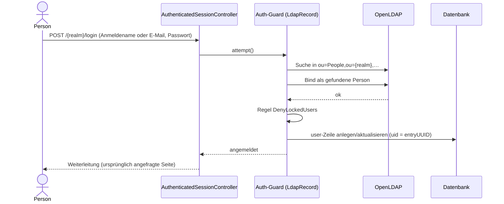
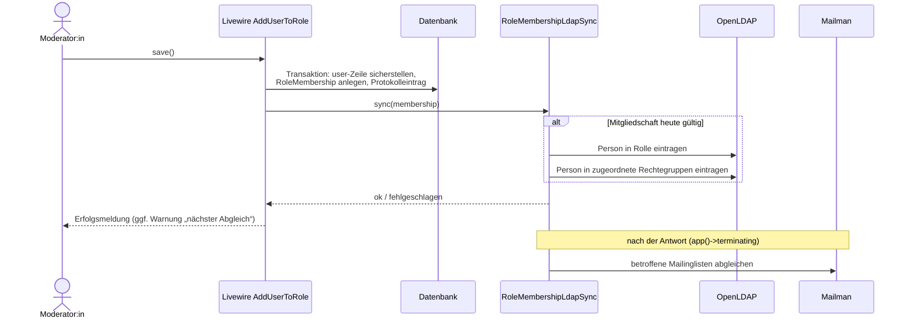
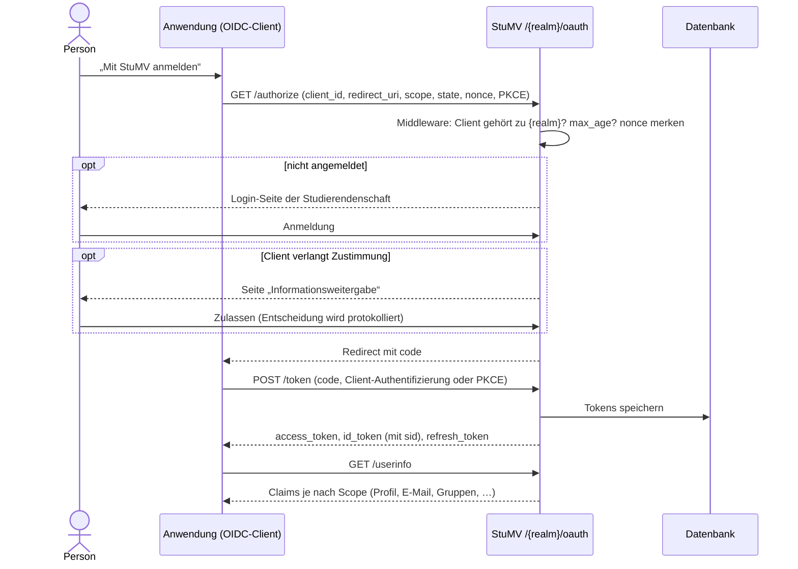
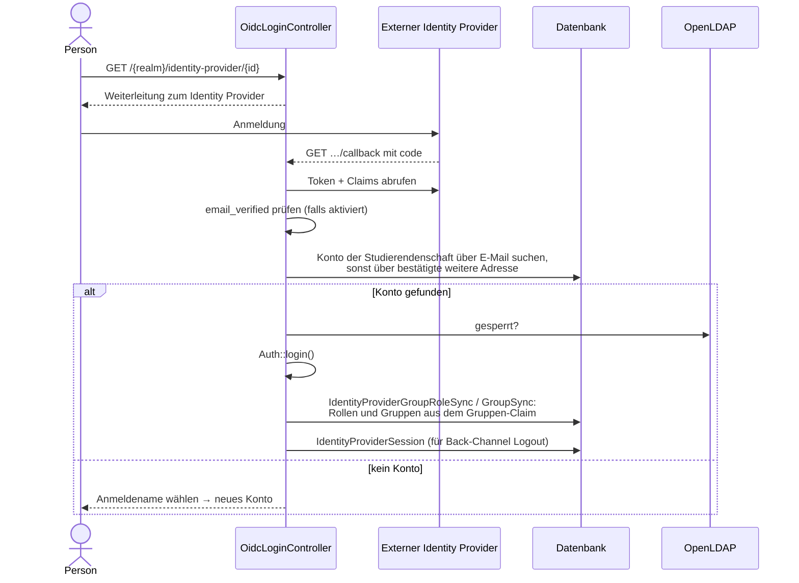
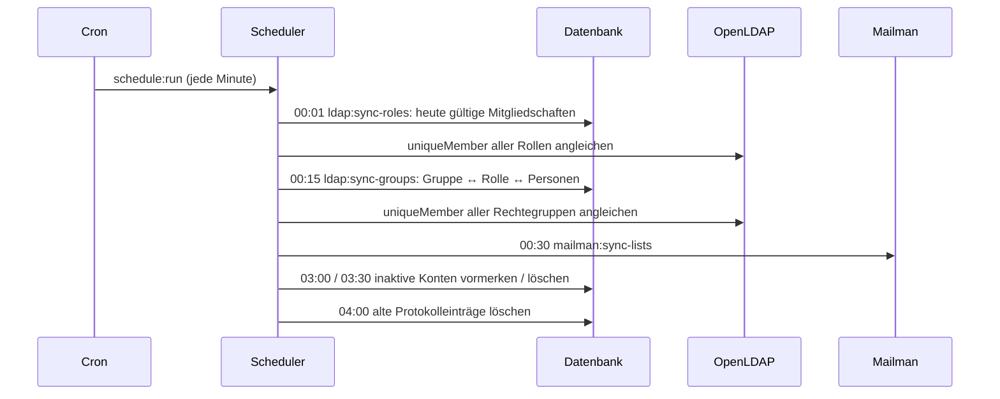

# 6. Laufzeitsicht

## Anmeldung

Die Anmeldung ist immer an eine Studierendenschaft gebunden. Der LDAP-Auth-Provider sucht das Konto nur unter `ou=People` dieser Studierendenschaft (`ScopedToRealmPeople`).

Passwörter liegen nur im LDAP; die Datenbank speichert keine nutzbaren Passwörter (`sync_passwords: false`).

## Person einer Rolle zuordnen

Beginnt die Mitgliedschaft erst in der Zukunft, ändert sich das LDAP noch nicht; der [nächtliche Abgleich](#nachtlicher-abgleich) trägt sie am Starttag ein.

## Anmeldung bei einer angebundenen Anwendung (OIDC)

Meldet sich die Person später bei StuMV ab, erhalten alle Clients mit Back-Channel-Logout-URL ein signiertes `logout_token` (`SendBackChannelLogoutNotification`).

## Anmeldung über einen externen Identity Provider

Rollen, die diese Synchronisation selbst vergeben hat (`identity_provider_id` gesetzt), werden beendet, sobald die Gruppe im Claim fehlt; andere Rollen bleiben unberührt.

## Nächtlicher Abgleich

Der Abgleich ist idempotent: Er überträgt nur Unterschiede und fängt damit auch Änderungen auf, deren sofortige Übertragung fehlgeschlagen ist. Administrator:innen können ihn über das Menü **Synchronisieren** jederzeit anstoßen; `LdapSyncDiff` zeigt vorher an, was sich ändern würde.
