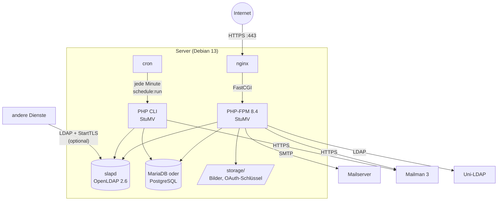
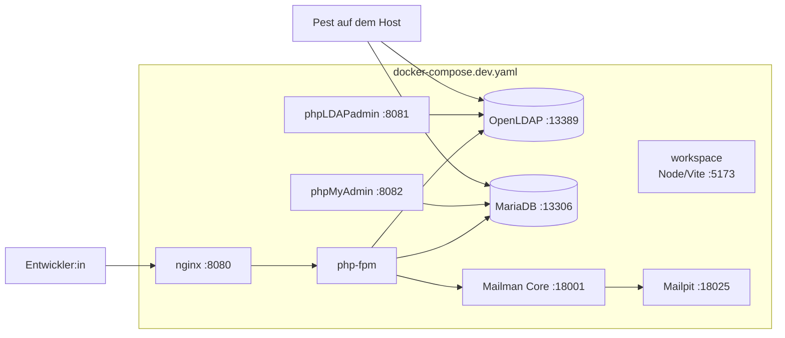
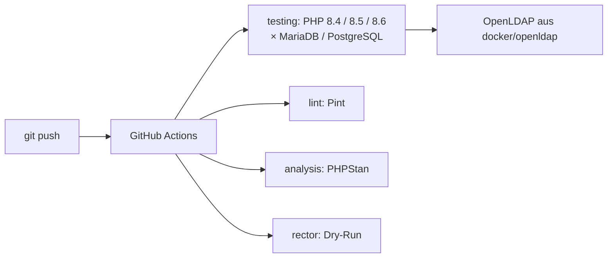

# 7. Verteilungssicht

## Produktion

Die Referenzinstallation läuft auf einem einzelnen Server. Die Schritte dafür beschreibt das [Administrationshandbuch](/admin/installation).

| Knoten | Hinweise |
| --- | --- |
| **nginx + PHP-FPM** | Dokumentenwurzel `public/`; `client_max_body_size` und PHP-Limits für Bild-Uploads anheben |
| **cron** | einziger Hintergrundprozess, kein Queue-Worker |
| **slapd** | lauscht lokal; für andere Dienste optional auf einer internen Adresse |
| **Datenbank** | lokal |
| **storage/** | `storage/app` (Uploads) und `storage/oauth-*.key` müssen gesichert werden |

Mehrere Anwendungsserver sind möglich, wenn Sitzungen in der Datenbank liegen (`SESSION_DRIVER=database`), `storage/` geteilt wird und der Scheduler nur auf einem Server läuft (`onOneServer()` ist bei den Aufgaben gesetzt, braucht dann aber einen gemeinsamen Cache).

## Entwicklung

Das OpenLDAP-Image wird aus `docker/openldap` gebaut: dieselbe Symas-Distribution und eine aus der Produktion abgeleitete `cn=config`. Die Testsuite und die CI nutzen dasselbe Image. Siehe [Entwicklungsumgebung](../entwicklungsumgebung).

## CI

