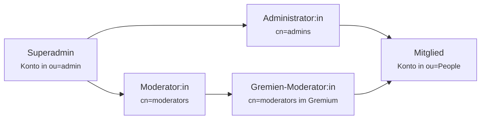

# 8. Querschnittliche Konzepte

## Mandantentrennung

Jede Studierendenschaft ist ein eigener Mandant (im Code *Realm* bzw. *Community*). Die Trennung zieht sich durch alle Schichten:

| Schicht | Umsetzung |
| --- | --- |
| **Routen** | alles Fachliche unter `/{realm}/…`; der Parameter wird zum `App\Ldap\Community`-Modell aufgelöst |
| **LDAP** | eigener Teilbaum `ou=<kürzel>,ou=Communities,…` mit eigenem `ou=People` |
| **Anmeldung** | das globale Scope `ScopedToRealmPeople` beschränkt den LDAP-Auth-Provider auf `ou=People` der Studierendenschaft aus der Route, aus `RealmContext` (z. B. bei der Registrierung über die Domain) oder aus dem angemeldeten Konto |
| **Konten** | ein Anmeldename kann in mehreren Studierendenschaften vorkommen und ist dann jeweils ein **eigenes Konto** (eigener LDAP-Eintrag, eigene `user`-Zeile je `(username, realm)`) |
| **OAuth/OIDC** | jeder Client hat eine `community_uid`; `EnsureOidcClientMatchesRealm` lehnt Clients einer anderen Studierendenschaft ab |
| **Datenbank** | Spalte `realm` an allen mandantenbezogenen Tabellen; `RealmDataPurger` räumt beim Löschen einer Studierendenschaft alle Tabellen ab |

## Berechtigungen

Die Zuständigkeiten sind LDAP-Gruppen, ausgewertet über das von `dynlist` erzeugte `memberOf`. Geprüft wird auf zwei Ebenen:

1. **Middleware in `routes/web.php`:** `communityMember`, `communityMod` (Moderator:in der Studierendenschaft oder eines übergeordneten Gremiums), `communityAdmin`, `SuperAdminMiddleware`, `denyAdminRealm` sowie Laravel-Gates (`can:moderator,realm`, `can:tools,realm`).
2. **Policies in `app/Policies/`:** `CommunityPolicy`, `CommitteePolicy`, `RolePolicy`, `GroupPolicy`, `DomainPolicy`, `MembershipPolicy`, `UserPolicy`.

Superadmins haben über `CommunityPolicy` in jeder Studierendenschaft die Rechte von Moderator:innen und Administrator:innen. Die Studierendenschaft `admin` selbst hat keine Gremien, Gruppen oder Domains; Seiten dafür sind mit `denyAdminRealm` gesperrt.

::: info Livewire-Aktionen
Folgeaktionen einer Livewire-Komponente (z. B. „Speichern“) laufen über Livewires eigenen Endpunkt. Damit die Zuständigkeiten auch dort geprüft werden, sind die fünf Middlewares in `AppServiceProvider::boot()` per `Livewire::addPersistentMiddleware()` registriert. Livewire stellt dabei die ursprüngliche Route nur auf der Anfrage wieder her – Middlewares müssen Parameter deshalb über `$request->route('realm')` lesen, nicht über `Route::current()`. Abgesichert durch `tests/Feature/Http/LivewirePersistentMiddlewareTest.php`.
:::

## Mitgliedschaften und LDAP-Abgleich

- **Führend ist die Datenbank** (`role_user_relation`, `role_group_relation`). Im LDAP stehen nur die heute gültigen Mitglieder von Rollen und Rechtegruppen.
- Nach jeder Änderung überträgt `RoleMembershipLdapSync` die betroffene Person sofort in Rolle und Gruppen. Schlägt das fehl, erscheint eine Warnung; der nächtliche Abgleich holt es nach.
- `ldap:sync-roles` und `ldap:sync-groups` gleichen nachts alle Rollen und Gruppen vollständig an (idempotent, nur Unterschiede). Damit greifen auch Start- und Enddaten in der Zukunft.
- `LdapSyncDiff` berechnet die Unterschiede für die Vorschau im Menü „Synchronisieren“, `LdapSyncState` speichert den Status zwischen und wird bei jeder Änderung an einer Mitgliedschaft verworfen.
- Mitgliedschaften werden **beendet** (`until` setzen) statt gelöscht, damit die Historie erhalten bleibt.

## LDAP-Zugriff

- Bibliothek: [LdapRecord](https://ldaprecord.com/) mit Laravel-Integration; Modelle in `app/Ldap/`.
- Verbindung immer mit **StartTLS** (`use_starttls: true`), Zertifikatsprüfung abschaltbar nur für Entwicklung.
- StuMV bindet als Service-Konto in `cn=write`; andere Dienste lesen mit eigenen Konten in `cn=read`. Die Zugriffsregeln stehen in `docker/openldap/config.ldif`.
- Passwörter hasht OpenLDAP mit Argon2 (`ppolicy` mit `olcPPolicyHashCleartext`); setzt StuMV ein Passwort selbst, hasht es vorab mit `PASSWORD_ARGON2ID`.
- Kontosperren setzt StuMV über `pwdAccountLockedTime`; die Regel `DenyLockedUsers` verhindert die Anmeldung. Die automatische Sperre von `ppolicy` ist abgeschaltet.
- Die letzte Anmeldung liefert `pwdLastSuccess` (`olcLastBind`), Grundlage für das Löschen inaktiver Konten.

## OpenID Connect Provider

Grundlage sind [Laravel Passport](https://laravel.com/docs/passport) 13 und `jeremy379/laravel-openid-connect`, mit folgenden Anpassungen:

| Thema | Umsetzung |
| --- | --- |
| **Endpunkte je Studierendenschaft** | Passports globale Routen sind abgeschaltet (`Passport::ignoreRoutes()`); `routes/web.php` registriert sie unter `/{realm}/oauth/…`, dazu Discovery, JWKS, UserInfo, End Session, Introspection und Revocation |
| **Mandantenbindung** | `EnsureOidcClientMatchesRealm` an Authorize, Token, Introspection und Revocation |
| **ID-Token** | `App\Services\Oidc\IdTokenResponse` ergänzt den Claim `sid`, fester Schlüssel-ID `kid` im JWKS |
| **Zustimmung** | je Client abschaltbar (`requires_consent`); Entscheidungen werden protokolliert (`LogOidcConsentDecision`) |
| **Öffentliche Clients** | ohne Secret nur mit PKCE (S256) |
| **Token-Laufzeiten** | Access Token 1 Stunde, Refresh Token 30 Tage, Refresh Tokens nur einmal verwendbar |
| **Reuse-Erkennung** | wird ein bereits verwendetes Refresh Token erneut vorgelegt, widerruft `ReuseDetectingRefreshTokenRepository` alle Tokens dieser Person für diesen Client |
| **`max_age`** | `EnforceMaxAge` erzwingt eine erneute Anmeldung |
| **Logout** | RP-Initiated Logout (`/end-session`) und Back-Channel Logout an alle Clients mit hinterlegter URL |
| **Rate Limiting** | Introspection und Revocation sind je `client_id` gedrosselt |

## Aktivitätsprotokoll

- `App\Support\ActivityLogger::record()` bzw. `recordAction()` an Modellen schreibt einen Eintrag mit Aktion, Studierendenschaft, Akteur, betroffenem Objekt und Details.
- Akteur ist das angemeldete Konto, ein Identity Provider oder das System (Scheduler, Befehle).
- Schlüssel, die nach Passwort, Secret oder Token aussehen, landen nie im Protokoll.
- Alte Einträge löscht `model:prune` nach `ACTIVITY_LOG_RETENTION_DAYS`, Anmeldungen ggf. früher.

## Sicherheit im Web

- **Content Security Policy** (`SetContentSecurityPolicy`): `script-src` ohne `unsafe-inline` und `unsafe-eval` (Livewire im CSP-sicheren Modus); `style-src` braucht `unsafe-inline`, weil Komponenten Stil-Attribute per JavaScript setzen.
- **Passwortregeln:** mindestens 12 Zeichen, gemischte Groß- und Kleinschreibung, Ziffern, Sonderzeichen, Prüfung gegen bekannte Datenlecks.
- **Sitzungen** in der Datenbank; Mitglieder sehen und beenden sie unter *Profil → Sitzungen*.
- **Login-Drosselung** nach mehreren Fehlversuchen.

## Datenschutz

- Weitergabe an OIDC-Clients nur im Umfang der Scopes und – sofern aktiviert – nach Zustimmung.
- Inaktive Konten: Benachrichtigung nach `ACCOUNT_INACTIVE_AFTER_DAYS`, Löschung nach `ACCOUNT_DELETION_GRACE_DAYS` (`AccountPurger` entfernt LDAP-Eintrag, alle Datenbankzeilen und Dateien).
- Profilbilder sind öffentlich; das wird beim Hochladen angezeigt.

## Barrierefreiheit

Tätigkeits-Bescheinigungen werden als **getaggtes PDF/UA-2** erzeugt (`MembershipCertificatePdf` mit tc-lib-pdf): Überschriften und Tabellen sind als Struktur ausgezeichnet, Linien als Artefakte, Links als Annotationen im Strukturbaum.

## Internationalisierung

- Texte in `lang/de` und `lang/en`; `SetLocale` wählt anhand von `Accept-Language`.
- Neue Texte immer in beiden Sprachen anlegen; fehlende Übersetzungen fallen in Tests auf, weil dann der Schlüssel erscheint.

## Fehlerbehandlung

- Nicht gefundene LDAP-Objekte (z. B. eine unbekannte Studierendenschaft in der URL) werden als `404` dargestellt.
- Fehlende OAuth-Schlüssel führen zu `403` statt zu einer Fehlermeldung mit Dateipfaden.
- Schlägt die sofortige LDAP-Übertragung fehl, bleibt die Änderung in der Datenbank erhalten und wird nachts übertragen.
