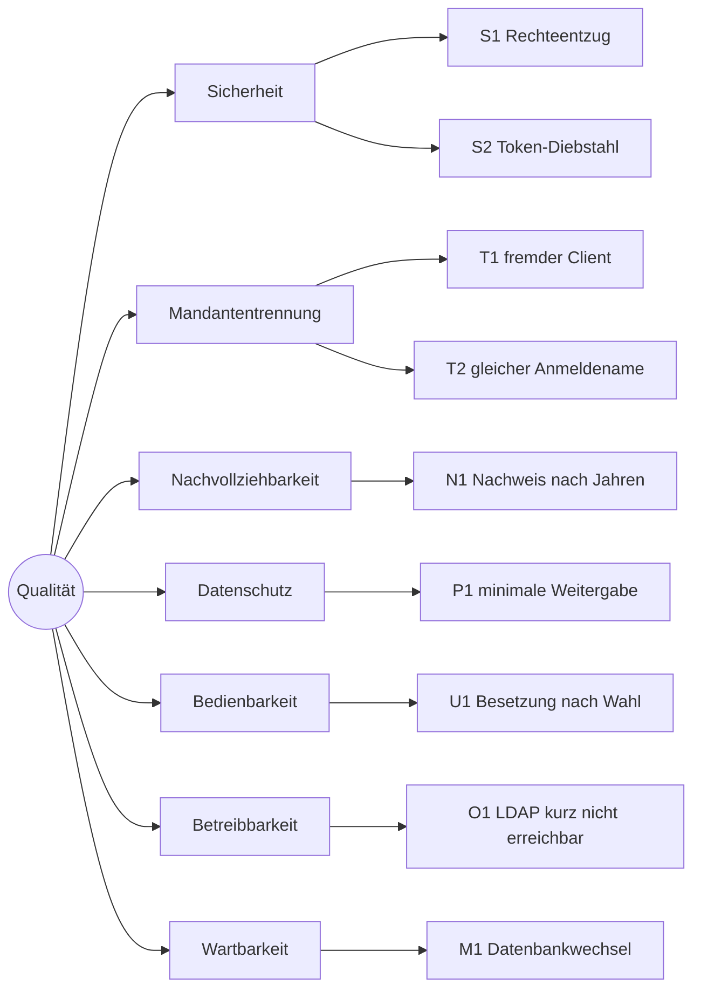

# 10. Qualitätsanforderungen

## Qualitätsbaum

## Qualitätsszenarien

| ID | Szenario | Erwartete Reaktion |
| --- | --- | --- |
| **S1** | Eine Moderatorin beendet die Mitgliedschaft einer Kassenverantwortlichen mit sofortiger Wirkung. | Die Person verschwindet sofort aus Rolle und Rechtegruppen im LDAP; bei der nächsten OIDC-Anmeldung fehlt die Gruppe im Token. |
| **S2** | Ein gestohlenes, bereits verwendetes Refresh Token wird erneut eingesetzt. | Alle Tokens dieser Person für diesen Client werden widerrufen; die Person muss sich neu anmelden. |
| **T1** | Ein OIDC-Client der Studierendenschaft A ruft `/B/oauth/authorize` auf. | Die Anfrage wird abgelehnt. |
| **T2** | `anna` gibt es in den Studierendenschaften A und B. | Es sind zwei unabhängige Konten; eine Administratorin von A kann `anna` in B weder sehen noch ändern. |
| **N1** | Eine Person braucht drei Jahre nach Ende ihrer Amtszeit eine Bescheinigung. | Die beendete Mitgliedschaft ist mit Zeitraum und Beschluss vorhanden; das PDF lässt sich erzeugen. |
| **P1** | Ein Wiki fragt nur `openid profile` an. | E-Mail, Telefon, Adresse und Gruppen werden nicht übermittelt. |
| **U1** | Nach einer Wahl wird ein Gremium neu besetzt. | Moderator:innen beenden alle alten Mitgliedschaften in einem Schritt und tragen die neuen ein, ohne Hilfe der Betreiber:innen. |
| **O1** | Das LDAP ist beim Speichern einer Mitgliedschaft kurz nicht erreichbar. | Die Mitgliedschaft wird gespeichert, eine Warnung erscheint, der nächtliche Abgleich überträgt sie. |
| **M1** | Eine Installation soll PostgreSQL statt MariaDB nutzen. | Migrationen und Tests laufen auf beiden Datenbanken (in der CI geprüft). |
