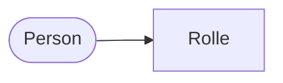

# Beitragen

## Ablauf

1. Lege einen Branch an und arbeite dort.
2. Ergänze oder passe Tests an – siehe [Tests](./tests).
3. Führe vor dem Commit `composer fix` aus.
4. Öffne einen Pull Request. Die CI muss grün sein.

Sicherheitslücken meldest du bitte nicht öffentlich, sondern per E-Mail an service@open-administration.de.

## Code-Qualität

| Befehl | Werkzeug | Wirkung |
| --- | --- | --- |
| `composer fix` | Rector, dann Pint | Refactorings anwenden und Code formatieren – vor jedem Commit |
| `composer pint` | Laravel Pint | nur formatieren |
| `composer rector-dry` | Rector | Vorschau ohne Änderungen |
| `composer lint` | PHPStan/Larastan | statische Analyse (Level 8, auch als GitHub-Workflow `analysis.yml`) |

### Hinweise zu PHPStan

- `phpstan/LdapRecordModelBuilder.stub` ergänzt Typangaben, die LdapRecord fehlen: `Group::find()`, `User::query()->…->first()` usw. liefern damit das konkrete Modell statt des Basismodells. Eigene Builder-Relationen sollten den Typ angeben, z. B. `@return Builder<Role>`.
- `phpstan/bootstrap.php` sagt Larastan, dass das angemeldete Konto `App\Models\User` ist und nicht das LDAP-Modell aus `config/auth.php`.
- Livewire-*Computed Properties* brauchen ein `@property-read` an der Klasse, Eloquent-Relationen einen Rückgabetyp mit Generics, z. B. `@return HasMany<Invitation, $this>`.
- Fehler bitte an der Ursache beheben, nicht per Baseline oder `@phpstan-ignore` unterdrücken.

## Continuous Integration

Jeder Push startet vier Workflows in `.github/workflows/`:

| Workflow | Prüft |
| --- | --- |
| `testing.yml` | Pest gegen PHP 8.4/8.5/8.6 × MariaDB/PostgreSQL, mit dem produktionsnahen OpenLDAP |
| `lint.yml` | Pint (`--test`) |
| `analysis.yml` | PHPStan |
| `rector.yml` | Rector (Dry-Run) |

Für `composer install` braucht die CI das Repository-Secret `COMPOSER_AUTH` mit den Flux-Pro-Zugangsdaten:

```json
{"http-basic":{"composer.fluxui.dev":{"username":"<e-mail>","password":"<lizenzschlüssel>"}}}
```

## Konventionen

### Routen und Berechtigungen

- Alles, was zu einer Studierendenschaft gehört, liegt unter `/{realm}/…`. Der Parameter wird zum `App\Ldap\Community`-Modell aufgelöst.
- Berechtigungen prüfen Middleware-Gruppen in `routes/web.php` (`communityMember`, `communityMod`, `communityAdmin`, `can:…`) und die Policies in `app/Policies/`.
- **Livewire-Aktionen laufen über eigene Requests.** Livewire wiederholt dort nur Middlewares, die als persistent registriert sind. Eine neue Berechtigungs-Middleware gehört deshalb in die Liste in `AppServiceProvider::boot()` und muss Route-Parameter über `$request->route(…)` lesen, nicht über `Route::current()`.
- Funktionen ohne Sinn in der Studierendenschaft `admin` schützt zusätzlich die Middleware `denyAdminRealm`.

Näheres unter [Querschnittliche Konzepte](./architektur/08-querschnittliche-konzepte#berechtigungen).

### Änderungen protokollieren

Jede fachliche Änderung wird im Aktivitätsprotokoll festgehalten, über `App\Support\ActivityLogger` bzw. `recordAction()` an den Modellen. Neue Aktionen brauchen eine Übersetzung unter `activity_log.actions` in `lang/de` und `lang/en`, sonst erscheint im Protokoll der Schlüssel.

### Mitgliedschaften und LDAP

Rollen- und Gruppenmitgliedschaften werden **in der Datenbank** geändert und danach ins LDAP übertragen (`RoleMembershipLdapSync`). Schreibe Mitglieder von Rollen oder Rechtegruppen nie direkt ins LDAP, der nächste Abgleich würde sie überschreiben. Siehe [Lösungsstrategie](./architektur/04-loesungsstrategie).

### Oberflächentexte

- Alle Texte stehen in `lang/de/*.php` und `lang/en/*.php`, nie direkt in den Views.
- Die deutsche Oberfläche duzt und gendert mit Doppelpunkt (*Moderator:innen*).
- Bei UI-Texten nur das Nötige: keine Untertitel oder Beschreibungen, nur weil eine Komponente sie anbietet.

### Datenbank

- Neue Migrationen müssen auf MariaDB **und** PostgreSQL laufen. Nutze Laravels Schema-Builder statt rohem SQL.
- Bereits ausgeführte Migrationen werden nicht nachträglich geändert. Ausnahme sind Korrekturen, die das Ergebnis auf bestehenden Installationen nicht verändern.

### Kommentare

Kommentare erklären knapp das *Warum*, wo es nicht offensichtlich ist – eine Zeile statt eines Absatzes.

### Beispielnamen

Erfundene Personennamen in Seedern, Testdaten und der Dokumentation dürfen keine belasteten Initialen ergeben (etwa SS, HH, SA, NS, KZ), da die Oberfläche Initialen in den Avataren anzeigt.

## Dokumentation

Diese Dokumentation liegt in `docs/` und wird mit [VitePress](https://vitepress.dev/) gebaut. Diagramme werden mit [Mermaid](https://mermaid.js.org/) direkt im Markdown geschrieben:

````md

````

| Befehl | Wirkung |
| --- | --- |
| `npm run docs:dev` | Vorschau mit Live-Reload |
| `npm run docs:build` | statische Seite bauen, prüft tote Links |
| `npm run docs:screenshots` | Screenshots des Benutzerhandbuchs neu erzeugen (siehe `docs/screenshots/README.md`) |

Die API-Referenz unter [Verzeichnis-API](./api/) wird aus `docs/dev/api/openapi.yaml` erzeugt. Ändert sich die API, passe die Spezifikation im selben Pull Request an.
