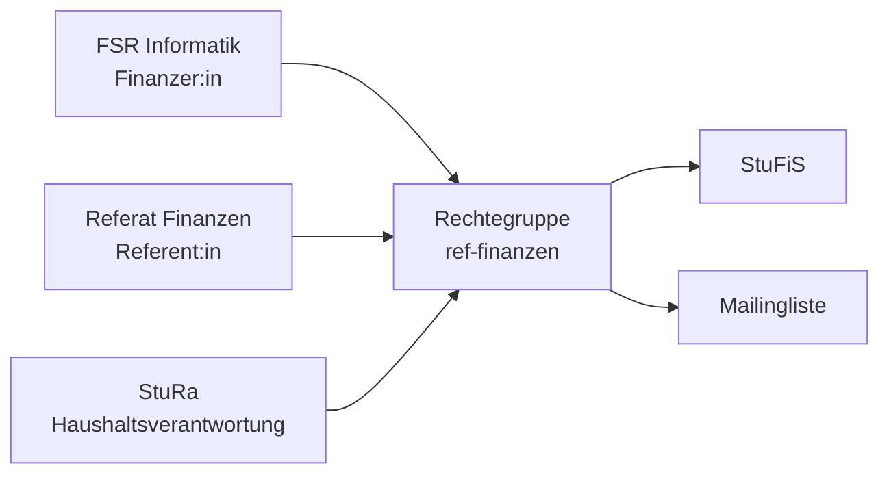

# Rechtegruppen

Rechtegruppen (in der Seitenleiste: **Rechte**) verbinden Rollen mit Berechtigungen in anderen Anwendungen. Statt einzelnen Personen Rechte zu geben, ordnest du einer Gruppe **Rollen** zu. Wer eine dieser Rollen innehat, ist automatisch Mitglied der Gruppe – und verliert die Mitgliedschaft automatisch, sobald die Rolle endet.

Rechtegruppen verwalten nur Administrator:innen.

::: warning Kürzel nicht ändern
Angeschlossene Anwendungen erkennen eine Gruppe an ihrem Kürzel. Änderst du es, verlieren die Mitglieder dort ihre Rechte, bis die Anwendung umgestellt ist. Das gilt insbesondere für die Gruppen der Finanzrechte im StuFiS.
:::

## Rechtegruppe anlegen

1. Öffne **Rechte** und klicke auf **Neue Rechtegruppe**.
2. Gib ein **Kürzel für die Rechtegruppe** und eine **Beschreibung** ein. Die Beschreibung sollte erklären, wofür die Gruppe gedacht ist und welche Anwendung sie nutzt.
3. Speichere. Du wirst direkt zur Rollenzuordnung weitergeleitet.

## Rollen zuordnen

1. Öffne bei der Gruppe **Rollen verwalten** und klicke auf **Rolle hinzufügen**.
2. Wähle ein **Gremium** und anschließend eine oder mehrere **Rollen** daraus.
3. Speichere.

Eine Zuordnung entfernst du in der Rollenliste der Gruppe über das Menü der Rolle.

## Mitglieder einer Gruppe

Über **Mitglieder anzeigen** siehst du alle Personen, die der Gruppe über eine Rolle angehören, und ob sie bereits ins Verzeichnis (LDAP) übertragen wurden. Änderungen kommen spätestens mit dem nächtlichen Abgleich an; sofort geht es über [Synchronisation](./synchronisation).

## Gruppe bearbeiten oder löschen

Über **Bearbeiten** änderst du die Beschreibung. Beim Löschen musst du den Namen zur Bestätigung eintippen. Alle Mitglieder verlieren danach die damit verbundenen Rechte in den angeschlossenen Anwendungen.
