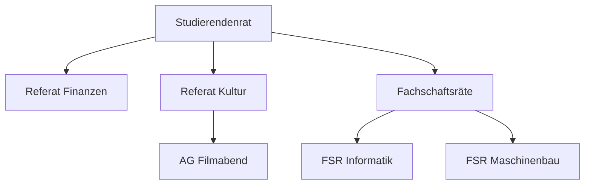
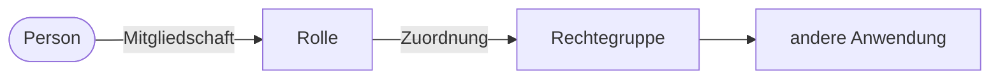

# Grundbegriffe

## Studierendenschaft

Die Organisation, zu der dein Konto gehört. In StuMV heißt sie auch *Studischaft* oder (technisch) *Realm*. Eine StuMV-Installation kann viele Studierendenschaften getrennt voneinander verwalten. Jede hat ein **Kürzel**, das in allen Adressen vorkommt, z. B. `https://stumv.example.org/stura/dashboard`.

## Mitglied

Eine Person mit einem Konto in einer Studierendenschaft. Mitglied wird man in der Regel automatisch: Wer sich mit einer E-Mail-Adresse registriert, deren Domain bei der Studierendenschaft hinterlegt ist, wird ihr direkt zugeordnet (siehe [Domains](/user/administration/einstellungen#domains)). Alternativ können Moderator:innen Personen [einladen](/user/moderation/hilfsmittel#zur-registrierung-einladen).

## Gremium

Ein Gremium, eine Organisation oder eine Gliederung, kurz: **Gremium**. Gremien können ineinander verschachtelt sein, z. B.:

## Rolle

Eine Funktion innerhalb eines Gremiums, z. B. *Mitglied*, *Sprecher:in* oder *Haushaltsverantwortung (HHV)*. Jede Rolle hat ein Kürzel und einen ausgeschriebenen Namen.

## Mitgliedschaft (Rollenzuordnung)

Die Zuordnung einer Person zu einer Rolle. Jede Mitgliedschaft hat

- ein **Startdatum** (Pflicht),
- ein **Enddatum** (optional – ohne Enddatum gilt sie unbefristet),
- ein **Beschlussdatum** und einen **Kommentar** (optional, nur zur Dokumentation).

Liegt das Startdatum in der Zukunft, wird die Mitgliedschaft erst dann aktiv. Beendete Mitgliedschaften bleiben erhalten – so entsteht eine Historie, aus der Mitglieder später eine [Tätigkeits-Bescheinigung](/user/mitglieder/mitgliedschaften#tatigkeits-bescheinigung-erstellen) erzeugen können.

## Rechtegruppe

Eine Gruppe, die Rechte in anderen Anwendungen bündelt, z. B. „darf im StuFiS Finanzanträge genehmigen“ oder „steht auf der Mailingliste des Vorstands“. Rechtegruppen werden **nicht direkt Personen**, sondern **Rollen** zugeordnet. Alle Personen, die aktuell eine dieser Rollen innehaben, sind damit Mitglied der Rechtegruppe.

Endet die Mitgliedschaft in der Rolle, endet automatisch auch die Mitgliedschaft in der Rechtegruppe.

## Moderator:in und Administrator:in

Besondere Zuständigkeiten innerhalb einer Studierendenschaft – siehe [Zuständigkeiten & Rechte](./zustaendigkeiten).
